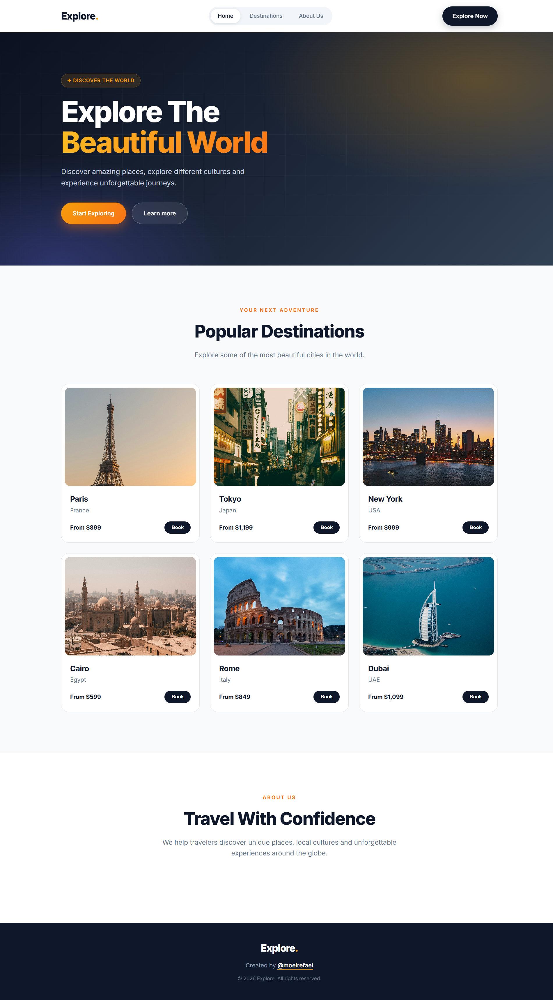
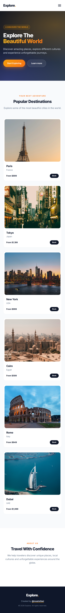

# Explore. 🌍

A modern, responsive travel landing page built with **HTML5, CSS3 and vanilla JavaScript** — no frameworks, no build step. Browse popular destinations and book a trip through an interactive booking form.

## Screenshots

### Desktop


### Mobile


## Features

- 🎨 Modern design: glass navbar, gradient hero, rounded cards and soft shadows
- 📱 Fully responsive, with a hamburger menu on mobile
- 🏙️ Destination cards generated from a JavaScript array
- 🖼️ Full-width place photos, with the place's emoji shown on hover
- 📝 Booking modal with the place's photo, validation and a live price estimate
- ✨ Sticky header, active-link highlighting and smooth scrolling

## Tech Stack

| Layer | Used |
|-------|------|
| Structure | HTML5 |
| Styling | CSS3 (Grid, Flexbox, custom properties, animations) |
| Logic | Vanilla JavaScript (ES6) |
| Font | [Inter](https://fonts.google.com/specimen/Inter) via Google Fonts |

## Project Structure

```
explore/
├── index.html
├── style.css
├── script.js
├── README.md
└── images/
    ├── paris.jpg
    ├── tokyo.jpg
    ├── new-york.jpg
    ├── cairo.jpg
    ├── rome.jpg
    ├── dubai.jpg
    ├── desktop_view.png
    └── mobile_view.png
```

## Getting Started

1. Clone the repository
   ```bash
   git clone https://github.com/<your-username>/<repo-name>.git
   ```
2. Open the folder and double-click `index.html` — or use a local server such as the VS Code **Live Server** extension.

## Customization

**Add or edit destinations** in the `destinations` array at the top of `script.js`:

```js
{ name: 'Paris', focus: 'center 25%', country: 'France', price: 899, icon: '🗼', bg: 'linear-gradient(...)' }
```

- Place the photo in `images/` named after the place in lowercase (`paris.jpg`; for two words use `new-york.jpg`).
- `focus` controls which part of the photo stays visible when it is cropped to fit the card.
- `icon` is the emoji shown when hovering the image.

**Change colors** from the CSS variables at the top of `style.css` (`--orange`, `--ink`, …).

## Notes

The booking form validates input and shows a confirmation on screen, but it does not send data anywhere. To receive bookings, connect it to a backend or a form service (e.g. Formspree, EmailJS).

## Author

Created by [@moelrefaei](https://www.linkedin.com/in/moelrefaei)
